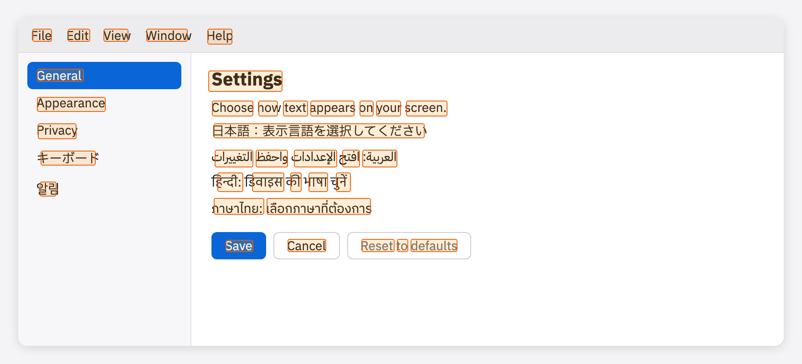

<div align="center">

# yomi

OCR for screens. Pure Go, models built in, every major script, the same words on macOS, Linux and Windows.

[](https://pkg.go.dev/github.com/y3owk1n/yomi)
[](https://github.com/y3owk1n/yomi/actions/workflows/ci.yml)
[](LICENSE)

|  macOS  |  Linux  |  Windows  |
| :-----: | :-----: | :-------: |
| arm64, amd64 | arm64, amd64 | arm64, amd64 |

</div>

---



yomi reads the text on a screen. Give it a capture of an app window, a menu,
a terminal or a web page, and it returns every line with its words, a box for
each word and each character, and how sure it is of each word. It was built
for [Neru](https://github.com/y3owk1n/neru), which puts a hint on anything you
can click and moves a cursor through any window's text.

## Why yomi

- **Reads what screens draw.** Interface text at 11 to 30 pixels, light and
  dark, on flat colour, gradients, bars and the plain parts of pictures, at
  1x, 2x and the scales between.
- **Every script, no language setting.** Latin, Cyrillic, Greek, Chinese,
  Japanese, Korean, Arabic, Hebrew, nine Indic scripts, Thai, Lao, Khmer,
  Myanmar, Georgian, Armenian and Ethiopic. A small router picks each line's
  script, so a page that mixes them reads in one call.
- **Fast.** 30 to 40 ms for a window on a laptop CPU. The hot loops run in
  NEON on arm64 and AVX2 on amd64.
- **Small.** One Go package per script family, 0.1 to 3.6 MB each, 7.1 MB
  for all of them. A program links only the scripts it imports.
- **The same everywhere.** No cgo, no inference runtime, no system library,
  and nothing downloads. The same pixels read to the same words on every
  platform.
- **Private.** No network calls, no logs. Frames and the text read from them
  exist only for the call.

## Install

```sh
go get github.com/y3owk1n/yomi
```

Go 1.27 or later. It builds for every target Go supports with
`CGO_ENABLED=0`.

## Quick start

```go
m, err := western.Model() // github.com/y3owk1n/yomi/models/western
if err != nil {
	return err
}
e := yomi.New(m)
lines, err := e.Read(ctx, frame, 2) // frame is an *image.RGBA, 2 on a Retina display
if err != nil {
	return err
}
for _, l := range lines {
	for _, w := range l.Words {
		fmt.Println(w.Text, w.Box, w.Confidence)
	}
}
```

To read any script, give one engine every recognizer and the router:

```go
e := yomi.New(westernModel,
	yomi.WithModel(cjkModel),
	yomi.WithModel(rtlModel),
	yomi.WithModel(indicModel),
	yomi.WithModel(seaModel),
	yomi.WithModel(caucasianModel),
	yomi.WithRouter(routerModel))
```

The [guide](docs/guide.md) covers scale, results, single lines, concurrency
and what yomi does not read.

## Models

| Package | Scripts | Size |
| :------ | :------ | ---: |
| `models/western` | Latin with European, Turkish and Vietnamese letters, Cyrillic, Greek | 0.5 MB |
| `models/cjk` | Simplified and Traditional Chinese, Japanese, Korean | 3.6 MB |
| `models/rtl` | Arabic with Persian and Urdu letters, Hebrew | 0.8 MB |
| `models/indic` | Devanagari, Bengali, Gurmukhi, Gujarati, Tamil, Telugu, Kannada, Malayalam, Sinhala | 1.1 MB |
| `models/sea` | Thai, Lao, Khmer, Myanmar | 0.5 MB |
| `models/caucasian` | Georgian, Armenian, Ethiopic | 0.5 MB |
| `models/router` | names each line's script family | 0.1 MB |
| `models/latin` | printable ASCII only | 0.6 MB |

Every recognizer also reads ASCII, so an interface that mixes English into
Russian or Thai reads with one model.

## How well it reads

Against Apple Vision's accurate mode, the best OCR macOS ships. 1x / 2x.

| Text | yomi | Vision accurate |
| :--- | :--- | :-------------- |
| Interface text, 17 Western languages | **95.4% / 95.8%** | 86.3% / 86.3% |
| Interface text, Chinese, Japanese, Korean (characters) | **96.6% / 96.9%** | 94.1% / 93.7% |
| Interface text, Thai (characters) | **97.8% / 98.0%** | 94.7% / 94.7% |
| Interface text, Hebrew | **86.1% / 86.5%** | 2.2% / 2.3% |
| Interface text, Arabic | **81.8%** / 84.5% | 81.6% / **87.3%** |
| Interface text, Hindi | 90.2% / 91.0% | **92.1% / 92.4%** |
| 28 live captures of apps and web pages, 15 languages | **80.8%** | 65.5% |
| Time per window or page | **30 to 40 ms** | 0.1 to 1.4 s |

On Linux and Windows yomi reads more than tesseract and Windows.Media.Ocr on
nearly every set, 30 to 140 times faster than tesseract and 3 to 23 times
faster than Windows.Media.Ocr.
[Benchmarks](docs/benchmarks.md) has every comparison, including PaddleOCR,
and how to run them yourself.

## Command line

```sh
go install github.com/y3owk1n/yomi/cmd/yomi@latest
yomi read -model auto -scale 2 shot.png     # every recognizer, routed
yomi read -model western -scale 1 shot.png
yomi bench -model auto DIR                  # times and reads an evaluation set
```

## Build on yomi

Neru reads with yomi for its hints and its vim mode. Anything that needs the
text on screen and where it sits can do the same: keyboard navigation,
screen search, automation where an app has no accessibility tree, or
reading an interface in a language you do not know.

## Documentation

Start at [docs/](docs/README.md): the guide, how it works, benchmarks,
training, and the record of design decisions.

## Contributing

Reports of text yomi reads wrong help most. Fonts, word lists and trained
models are welcome too, and anyone can score a model on the open evaluation
set, on any platform. Start with [CONTRIBUTING.md](CONTRIBUTING.md).

## License

MIT. See [LICENSE](LICENSE). The models are MIT too, trained only on open
fonts and open word lists.

<div align="center">
<br/>

Made by <a href="https://github.com/y3owk1n">y3owk1n</a>

</div>
